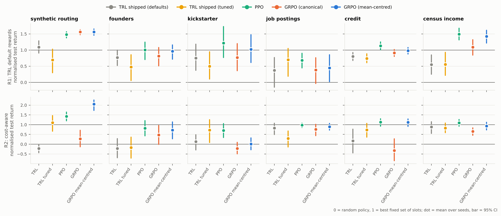

# grpo-trl

**Can PPO or GRPO train Think-Reason-Learn's `VerifiableRL` better than the optimiser it ships with? A
pre-registered study.**

[Think-Reason-Learn](https://github.com/Vela-Research/think-reason-learn) (TRL) is Vela Research's open-source
library of scikit-learn classifiers that reason with language models. One of its six models, `VerifiableRL`,
uses reinforcement learning: a policy decides which piece of information about a sample to reveal next, or to
stop, and a classifier predicts from what was revealed. TRL trains that policy by distilling Monte Carlo rollout
targets. This repository tests two standard policy-gradient methods, Proximal Policy Optimization (PPO) and Group
Relative Policy Optimization (GRPO), against that shipped optimiser, on TRL's own decision problem, with
everything but the optimiser held fixed.

> "TRL" here always means Think-Reason-Learn, not Hugging Face's Transformer Reinforcement Learning library.

**Start with [`REPORT.md`](REPORT.md).**

## The result in six lines

1. **PPO clearly beats TRL's shipped optimiser** at equal compute, at both budgets tried (+0.50 and +0.55), in
   about half the wall-clock time.
2. **TRL's optimiser cannot learn when to stop**, and as shipped it does not improve with four times the budget.
3. **GRPO as published does not beat TRL's optimiser**: level with it overall, worse where stopping matters, and
   clearly behind PPO (-0.50 normalised units, 95% CI -0.59 to -0.41).
4. **One change repairs GRPO for a short run: do not divide by the group's standard deviation.** That
   "mean-centred" variant beats TRL's optimiser at the standard budget (+0.41) and is within 0.09 of PPO there,
   **but it collapses when trained four times as long**, and a fix aimed at the diagnosed cause only partly helped.
5. **Of the two challengers, PPO is the robust one**: best at both budgets, fewest failed runs.
6. **For TRL:** offer a whole-episode policy-gradient optimiser, and make it PPO. A tested TRL-native
   implementation of the critic-free variant is in [`contrib/trl`](contrib/trl/README.md) as a starting point.

| Optimiser | One budget: 12 conditions, 10 seeds | Four budgets: 4 conditions, 3 seeds |
|---|---|---|
| TRL shipped, defaults | 0.49 [0.39, 0.60] | 0.37 [0.12, 0.61] |
| TRL shipped, tuned | 0.60 [0.48, 0.71] | 0.87 [0.58, 1.18] |
| PPO | **1.10** [1.02, 1.17] | **1.42** [1.24, 1.60] |
| GRPO, canonical | 0.60 [0.50, 0.70] | 0.75 [0.46, 1.03] |
| GRPO, mean-centred | 1.01 [0.93, 1.09] | 0.95 [0.63, 1.23] |

Normalised test return: 0 = a random policy, 1 = the best policy that does not adapt to what it sees. Mean with
95% CI. One budget = the compute of one default TRL pass over the training set.



## How the question got here

The study started from a narrower question, which is where the repository's name comes from: TRL was believed to
use PPO, and the question was whether GRPO would do better. An audit of the code came first and found that TRL
does not use PPO at all. That made both methods challengers to the optimiser TRL actually ships, which is the
comparison this repository is now organised around.

Two consequences are worth knowing when reading the results:

- **The hypotheses were registered around GRPO**, before any experiment, and are reported exactly as registered,
  including the one that came out the opposite way (GRPO was predicted to beat PPO).
- **PPO against TRL's optimiser was not one of the registered tests.** It is the study's clearest result, and it
  is reported as a descriptive comparison with unadjusted intervals, not as a confirmatory test.

## How the study was run

- **Pre-registered.** Hypotheses, metrics, statistics and the decision rule were committed before any
  experiment; every later change is a dated amendment made before the confirmatory seeds were run
  ([`PLAN.md`](PLAN.md), [`docs/DEVIATIONS.md`](docs/DEVIATIONS.md)).
- **Only the optimiser varies.** Networks, action rule, rewards and the deployment loop are imported from the
  pinned library; the incumbent arm is TRL's own trainer code.
- **Equal compute, equal tuning.** Every arm gets the compute of one default TRL pass, counted on every network;
  every learner gets the same random search on separate dev seeds.
- **Paired and pooled statistics.** Same seeds for every arm; stratified bootstrap CIs, permutation tests, Holm
  correction.
- **Tested.** 35 tests check equivalence with TRL's action rule, rewards and rollout returns, the advantage
  formulas, the compute meter and the statistics.

## What is where

| Path | What |
|---|---|
| [`REPORT.md`](REPORT.md) | The write-up: question, method, results, limitations, recommendation |
| [`PLAN.md`](PLAN.md) | The pre-registration and its amendments |
| [`docs/METHODS.md`](docs/METHODS.md) | The method in full, with code pointers |
| [`docs/DEVIATIONS.md`](docs/DEVIATIONS.md) | Every departure from the plan |
| [`docs/REPRODUCE.md`](docs/REPRODUCE.md) | Commands to reproduce everything |
| [`results/summary/TABLES.md`](results/summary/TABLES.md) | Every table, generated from the raw records |
| `results/raw/` | One JSON record per run |
| `results/figures/` | Figures |
| `grpo_trl/` | The test bed: decision problem, compute meter, optimisers, data, analysis |
| `experiments/` | Launchers, budgets, tuning records, frozen configurations |
| [`contrib/trl`](contrib/trl/README.md) | The proposed change to TRL: patch, tests, pull-request text |
| `tests/` | The tests |

## Quick start

```bash
uv venv --python 3.13 .venv
```

```bash
source .venv/bin/activate
```

```bash
uv pip install -e ".[dev]"
```

```bash
python -m pytest tests -q
```

```bash
python -m grpo_trl.report
```

The last command rebuilds every table and figure from the committed run records.

## Scope and honesty notes

- The founder data is generated (from [`trl-for-angels`](https://github.com/Sidi3355/trl-for-angels)); VCBench
  was not available. Nothing here is a claim about real founders.
- Ten seeds resolve pooled differences of about 0.17 and larger. The four-budget, end-to-end and post hoc
  experiments are small (three to five seeds on four conditions).
- The `VerifiableRL` paper could not be retrieved; the incumbent is the library code at commit `a712645`.
- The framing above was adopted after the results were in (plan Amendment A5). No number, test or verdict
  changed; the pre-registered plan is kept as it was written.
