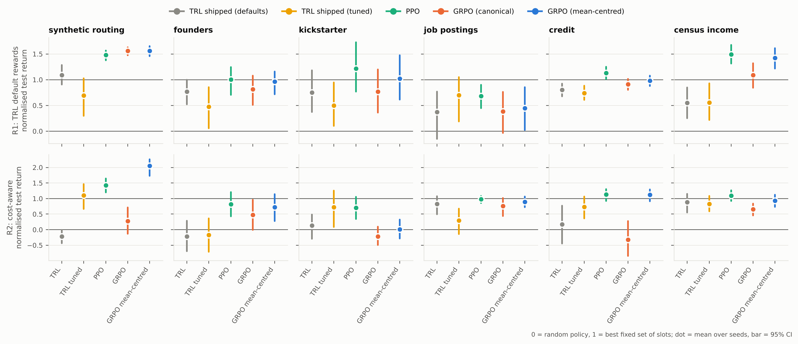
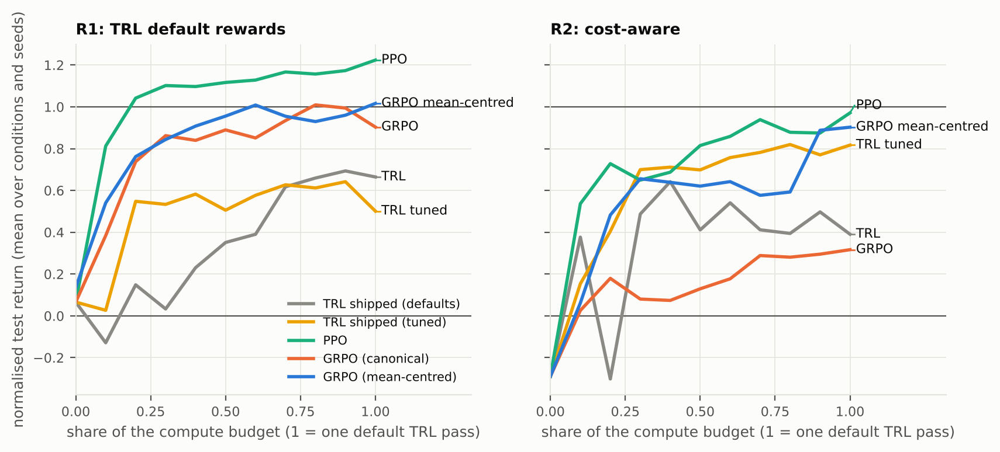
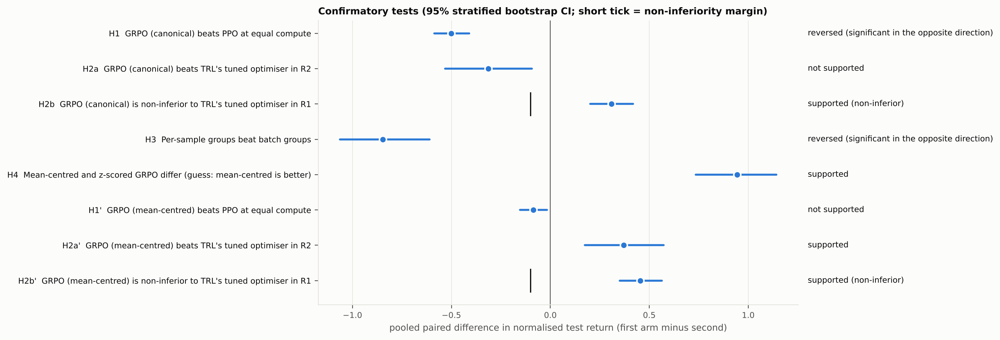
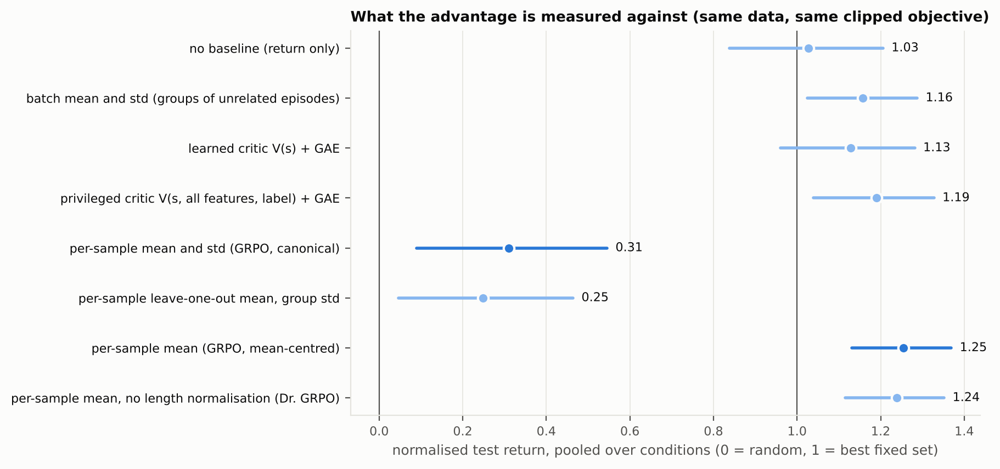
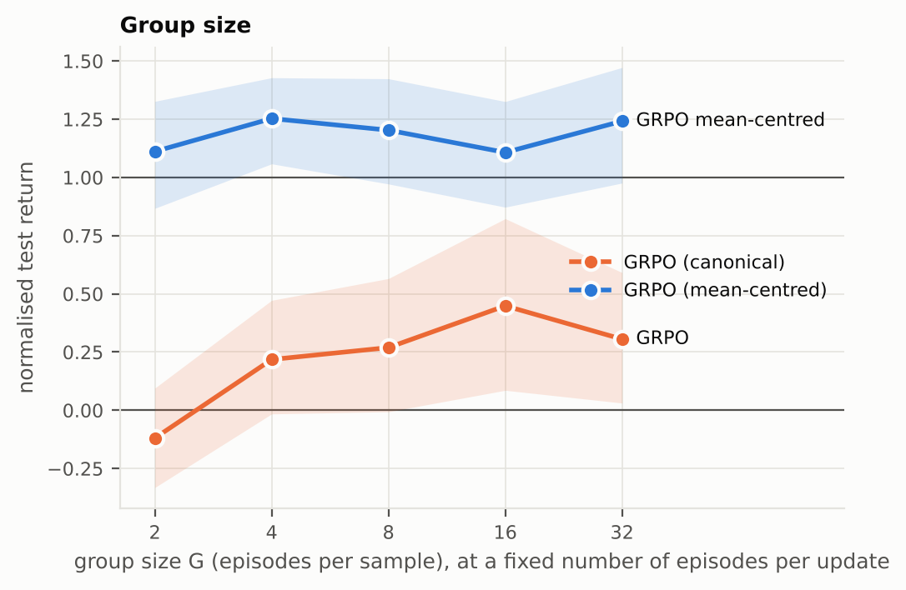

# PPO and GRPO against Think-Reason-Learn's policy optimiser

A pre-registered study on `VerifiableRL`, the reinforcement-learning model of Vela Research's
[Think-Reason-Learn](https://github.com/Vela-Research/think-reason-learn) (TRL).
22 November 2026. Plan: [`PLAN.md`](PLAN.md). Method in full: [`docs/METHODS.md`](docs/METHODS.md).
A shorter version in paper format is [`paper/paper.pdf`](paper/paper.pdf); this file is the long form.
Every number below is read off [`results/summary/TABLES.md`](results/summary/TABLES.md), which one command
regenerates from the raw run records.

## Summary

**The question.** TRL's `VerifiableRL` trains its policy by distilling Monte Carlo rollout targets. Would a
whole-episode policy-gradient method, Proximal Policy Optimization (PPO) or Group Relative Policy Optimization
(GRPO), train that policy better, at the same compute and with everything else unchanged?

**How the question got here.** The study started from a narrower one: TRL was believed to train its RL model
with PPO, and the question was whether GRPO would do better. An audit of the code found that TRL does not use
PPO: no policy gradient, no critic, no clipped objective. That made both methods challengers to the optimiser
TRL actually ships, and three were compared on TRL's own decision problem, with TRL's own networks, rewards and
deployment code: what TRL ships, PPO, and GRPO. The hypotheses were registered before any experiment, when GRPO
was the candidate of interest, and they are reported exactly as registered (section 4.2). PPO's comparison with
TRL's optimiser was not one of the registered tests; it is reported as a descriptive result with unadjusted
intervals.

**The answers.**

| Question | Answer | Evidence (pooled paired difference in normalised test return, 95% CI) |
|---|---|---|
| Does PPO beat what TRL ships? | **Yes, at every budget tried** | +0.50 [+0.40, +0.60] over tuned TRL at one budget, 9 of 12 conditions won and none lost; +0.55 [+0.31, +0.75] at four |
| Does GRPO, as published, beat what TRL ships? | **No.** About equal overall; worse where stopping matters | 0.00 [-0.12, +0.12] overall; -0.31 [-0.53, -0.09] in the cost-aware regime |
| Is there a GRPO that does? | **Partly: drop the division by the group's standard deviation** ("mean-centred GRPO"). It beats TRL's optimiser at a short budget and does not hold up over a long one | +0.41 [+0.30, +0.53] over tuned TRL at one budget; +0.08 [-0.16, +0.34] at four, where it falls from 1.35 to 0.95 |
| Which of the two challengers is better? | **PPO.** Far ahead of GRPO as published; tied or slightly ahead of mean-centred GRPO at one budget, clearly ahead at four | GRPO as published -0.50 [-0.59, -0.41] against PPO; mean-centred GRPO -0.09 [-0.15, -0.02] at one budget, -0.47 [-0.73, -0.22] at four |

Normalised return: 0 is a random policy, 1 is the best policy that does not adapt to what it sees. "One budget"
is the compute of one default TRL pass over the training set. Pooled over six datasets, two reward regimes and
ten seeds at one budget: **TRL's optimiser 0.49 (as shipped) and 0.60 (tuned), PPO 1.10, canonical GRPO 0.60,
mean-centred GRPO 1.01.** On four conditions and three seeds at four budgets: **TRL 0.37 (as shipped) and 0.87
(tuned), PPO 1.42, canonical GRPO 0.75, mean-centred GRPO 0.95.**

**Six findings.**

1. **PPO beats TRL's rollout-distillation optimiser at every budget tried,** at equal compute and in about half
   the wall-clock time. As shipped, TRL's optimiser does not improve at all with four times the budget.
2. **TRL's optimiser cannot learn when to stop.** Its STOP target is "was the call right, if I stopped now",
   so slot costs and step penalties never reach the stopping decision. In the cost-aware regime it reveals exactly
   its minimum number of slots on every dataset.
3. **GRPO as published does not beat TRL's optimiser, because of a specific defect in this problem.** Dividing
   each sample's advantages by that sample's own standard deviation gives a sample whose episodes differ only by
   a slot cost the same weight as a sample whose episodes differ by a right or a wrong call. At the initial
   policy, canonical GRPO's update points, on average, at a cosine of 0.24 from the true policy gradient (0.99
   without the division), and it learns to stop as early as it is allowed to.
4. **Removing that division repairs it for a short run, not for a long one.** Mean-centred GRPO beats TRL's
   optimiser at one budget, is within 0.09 of PPO there, and is the only method that found the adaptive optimum
   on the synthetic problem. Given four times the budget it climbs as high as PPO part-way through and then
   collapses in 8 of 12 runs. A fix suggested by a diagnosis of the collapse helped a little and did not cure it.
5. **Of the two challengers, PPO is the robust one.** Best at one budget, best at four, fewest failed runs (4%
   below a random policy at one budget, none at four).
6. **The one registered prediction about the challengers was reversed.** GRPO was predicted to beat PPO (H1). It
   did not; PPO beat it by 0.50.

**Recommendation.** Offer a whole-episode policy-gradient optimiser in `VerifiableRL`, and make it **PPO**. The
pre-registered rule, taken to the letter, selects mean-centred GRPO, because it passed both of its tests against
the shipped optimiser at one budget. The four-budget experiment, which the plan included to probe exactly this,
shows that variant is not yet safe to train for long, so the rule's answer is reported and not followed. Canonical
GRPO should not be offered. [`contrib/trl`](contrib/trl/README.md) holds a tested TRL-native implementation of
the critic-free variant (`optimizer="group"`): it is the smaller change and it won the end-to-end check, but it
is offered as a starting point for discussion with its limitation stated, not as the thing to merge as is.

**What this study cannot say.** Ten seeds resolve differences of about 0.17 or more; the 0.09 between PPO and
mean-centred GRPO at one budget is at the edge of that. The four-budget and end-to-end experiments are small
(three and five seeds, four conditions). The classifier was frozen in the main experiment. The founder data is
generated, and VCBench was not available, so nothing here is a claim about real founders.

---

## 1. The question, and how it got here

The question this report answers: *can a whole-episode policy-gradient optimiser, PPO or GRPO, train
`VerifiableRL`'s policy better than the optimiser TRL ships?*

The question the study started from was narrower: *one of TRL's six models uses PPO; is GRPO a better
alternative?* A code audit came first, and it changed the question. TRL has one reinforcement-learning model, `VerifiableRL`
(Ye, Alican, Griffin, Yin and Ihlamur, "Learning What to Ask: Cost-Aware Sequential Founder Evaluation",
MIDAS @ ECML-PKDD 2026). The string "PPO" appears nowhere in the library, its tests, its documentation or its git
history (upstream `a712645`, v0.4.4; the module is byte-identical in the v0.3.0 fork). What the code does:

- A sample's features come in named *slots* (education, jobs, ...). A policy network picks the next slot to
  reveal, or STOP; a classifier network predicts the label from what has been revealed.
- For each state an episode visits, each slot is revealed in turn and the current policy is rolled out
  `n_rollouts` times. The policy is then fitted by cross-entropy to `softmax(Q / tau_info)` over slots, and to
  `sigmoid(Q_stop / tau_stop)` for STOP, where `Q_stop` is the reward of stopping *now*.

That is rollout-based policy distillation. It is not a policy-gradient method.

So the study compares three families on one problem: TRL's shipped optimiser as the incumbent, and PPO and
GRPO as the two challengers. The paper itself
could not be read (its host was unreachable and it is not on arXiv); the audit is of the code, which TRL's
changelog says was checked against the paper.

## 2. Background

**PPO** (Schulman et al., 2017) is an actor-critic method: a learned value function supplies per-step
advantages, and the policy is improved on a clipped importance-weighted objective.

**GRPO** (Shao et al., 2024, DeepSeekMath) removes the critic. For each prompt it samples a group of G outputs
and scores each against its own group: `A_i = (r_i - mean(r)) / std(r)`, inside PPO's clipped objective.

**Outside language models, the evidence was against GRPO.** de Oliveira et al. (2025; AKCIT and OATML, Oxford)
found it underperforms PPO on Acrobot, MountainCar, HalfCheetah and Humanoid and holds its own only on
short-horizon CartPole. They gave two reasons: no per-step credit assignment over long horizons, and groups that
"mix potentially unrelated episodes", because classical control has no prompt.

**Why `VerifiableRL` looked like the right place for GRPO** (section 2.3 of the plan, written before any run):
each training sample is a natural prompt; episodes are at most five steps; the reward arrives at the end. And
the return depends on the label, which the policy never sees, so a critic `V(s)` cannot remove the variance the
hidden label causes, while a group of episodes on the same sample shares the label and removes it exactly.

## 3. Method in brief

Everything that defines the task is imported from TRL and identical for every arm: the policy and classifier
networks and their initialisation, the action rule, the reward, the deployment loop (`VerifiableRL._reveal`).
Only the policy optimiser varies. Details and code pointers are in [`docs/METHODS.md`](docs/METHODS.md).

- **Arms.** *TRL shipped (defaults)* and *TRL shipped (tuned)*: TRL's own trainer code, under a budget harness.
  *PPO*: clipped objective, learned critic, GAE. *GRPO (canonical)*: equation 3 of Shao et al., per-sample
  groups. *GRPO (mean-centred)*: the same without the division by the group's standard deviation (promoted from
  ablation arm to main arm, with its own hypotheses, after the pilot and before tuning: Amendment A1.3).
- **Two reward regimes.** *R1* is the library's defaults exactly (TP +4, FP -16, step -0.1, at least three
  slots, no slot costs). *R2* is a cost-aware regime built from existing `VerifiableRL` arguments: the return is
  balanced accuracy (as Youden's J) minus slot costs, STOP is allowed after one slot, and revealing everything
  costs half of what full information is worth.
- **Six datasets:** a synthetic problem whose best strategy is adaptive and known; the 3,000 founder profiles of
  `trl-for-angels` (six text slots, MiniLM embeddings); Kickstarter projects; job postings (4% fraudulent);
  credit default (one slot per month of history); census income. Fresh stratified split per seed (2,000 train,
  500 validation, 2,000 test).
- **Equal compute.** Every run gets the compute TRL's default trainer spends on one pass over the training set,
  counted in multiply-accumulates by hooks on every network, PPO's critic included. The endpoint is the policy
  at the end of the budget; no checkpoint is selected.
- **Equal tuning.** 24 random configurations per learner on dev seeds, the top three re-run on two more dev
  seeds, one frozen configuration per learner for all datasets and regimes. The incumbent got the same search,
  plus the right to set its own `min_queries`.
- **Frozen classifier.** The reward depends on the classifier, so in the main experiment it is trained once per
  (dataset, seed) by TRL's own pretraining and frozen for every arm. Section 4.7 removes this.
- **Statistics.** Runs are paired by seed. Each confirmatory test is the mean paired difference in normalised
  test return, pooled over conditions with equal weight: stratified bootstrap CI, sign-flip permutation p,
  Holm correction over eight tests.
- **Pre-registration.** Hypotheses, metrics, analysis and decision rule were committed before any experiment
  (`39ac496`); pilot-driven changes before tuning (`2c9c9ff`); frozen configurations before any confirmatory seed
  (`0ea0647`). Dev seeds (1000+) and confirmatory seeds (0 to 9) never mix. Deviations:
  [`docs/DEVIATIONS.md`](docs/DEVIATIONS.md).

## 4. Results

### 4.1 Main comparison (E1: 5 arms x 12 conditions x 10 seeds = 600 runs)

Normalised test return, mean over seeds with 95% CI. 0 = random policy, 1 = best fixed set of slots.

| Condition | TRL shipped (defaults) | TRL shipped (tuned) | PPO | GRPO (canonical) | GRPO (mean-centred) |
|---|---|---|---|---|---|
| synthetic routing, R1 | 1.09 [0.91, 1.29] | 0.69 [0.30, 1.03] | 1.48 [1.38, 1.57] | 1.56 [1.48, 1.63] | 1.56 [1.46, 1.65] |
| founders, R1 | 0.77 [0.52, 1.00] | 0.48 [0.05, 0.86] | 1.01 [0.71, 1.25] | 0.81 [0.51, 1.08] | 0.96 [0.72, 1.16] |
| kickstarter, R1 | 0.75 [0.37, 1.18] | 0.50 [0.10, 0.95] | 1.22 [0.77, 1.73] | 0.77 [0.36, 1.20] | 1.02 [0.61, 1.48] |
| job postings, R1 | 0.37 [-0.15, 0.77] | 0.70 [0.19, 1.05] | 0.68 [0.45, 0.90] | 0.38 [-0.04, 0.76] | 0.45 [0.02, 0.85] |
| credit, R1 | 0.80 [0.67, 0.93] | 0.74 [0.61, 0.89] | 1.13 [1.01, 1.25] | 0.91 [0.80, 1.02] | 0.98 [0.88, 1.08] |
| census income, R1 | 0.55 [0.25, 0.85] | 0.56 [0.21, 0.93] | 1.49 [1.31, 1.67] | 1.09 [0.84, 1.32] | 1.42 [1.22, 1.61] |
| synthetic routing, R2 | -0.22 [-0.43, -0.01] | 1.10 [0.67, 1.47] | 1.42 [1.20, 1.64] | 0.28 [-0.13, 0.72] | **2.05 [1.73, 2.26]** |
| founders, R2 | -0.22 [-0.69, 0.29] | -0.17 [-0.71, 0.36] | 0.82 [0.43, 1.20] | 0.48 [-0.01, 0.96] | 0.73 [0.28, 1.14] |
| kickstarter, R2 | 0.13 [-0.30, 0.48] | 0.72 [0.08, 1.25] | 0.70 [0.34, 1.05] | -0.22 [-0.49, 0.10] | 0.01 [-0.29, 0.33] |
| job postings, R2 | 0.82 [0.49, 1.08] | 0.29 [-0.14, 0.67] | 0.98 [0.86, 1.08] | 0.76 [0.44, 1.02] | 0.89 [0.73, 1.07] |
| credit, R2 | 0.17 [-0.45, 0.77] | 0.73 [0.36, 1.06] | 1.13 [0.92, 1.30] | -0.33 [-0.84, 0.27] | 1.12 [0.92, 1.30] |
| census income, R2 | 0.89 [0.55, 1.15] | 0.83 [0.59, 1.09] | 1.09 [0.93, 1.26] | 0.65 [0.46, 0.84] | 0.93 [0.73, 1.12] |

Pooled over the twelve conditions (none was dropped by the degeneracy guard):

| Arm | Normalised return [95% CI] | Interquartile mean | R1 | R2 | Seed-to-seed SD | Runs below random | Runs above best fixed set | Wall-clock per run |
|---|---|---|---|---|---|---|---|---|
| TRL shipped (defaults) | 0.49 [0.39, 0.60] | 0.62 | 0.72 | 0.26 | 0.57 | 23% | 24% | 38 s |
| TRL shipped (tuned) | 0.60 [0.48, 0.71] | 0.71 | 0.61 | 0.58 | 0.67 | 21% | 28% | 41 s |
| **PPO** | **1.10 [1.02, 1.17]** | 1.14 | 1.17 | 1.03 | 0.40 | 4% | 65% | 17 s |
| GRPO (canonical) | 0.60 [0.50, 0.70] | 0.69 | 0.92 | 0.27 | 0.54 | 23% | 37% | 23 s |
| **GRPO (mean-centred)** | **1.01 [0.93, 1.09]** | 1.04 | 1.07 | 0.96 | 0.43 | 8% | 52% | 21 s |

What the table shows:

- **PPO and mean-centred GRPO are the only arms that, on average, beat the best non-adaptive policy** (above 1).
- **Canonical GRPO is fine in R1 and fails in R2** (0.92 against 0.27). Section 4.4 explains why.
- **Tuning did not rescue TRL's optimiser.** The tuned configuration helps in R2 (0.26 to 0.58, almost all of it
  from being allowed a `min_queries` of two) and hurts in R1 (0.72 to 0.61). Against the *better* of the two TRL
  arms in each regime, PPO is ahead by 0.45 (R1) and 0.44 (R2), and mean-centred GRPO by 0.34 [0.26, 0.43] (R1)
  and 0.37 [0.18, 0.57] (R2).
- **On the one problem with a known adaptive optimum, mean-centred GRPO finds it and nothing else does.** On
  synthetic routing in R2 the best strategy is: read the router, read the candidate it names, stop. Mean-centred
  GRPO reveals 2.16 slots on average and scores 2.05; PPO reveals 3.99 and scores 1.42; TRL's tuned optimiser
  1.10; canonical GRPO 0.28.
- **The equal-compute budget is conservative for the new arms.** At equal multiply-accumulates they finish in
  about half the wall-clock time of TRL's trainer, because whole episodes batch better than per-state rollouts.

The policy-gradient arms reach the level of the best fixed slot set within a quarter of the budget in R1. TRL's
default optimiser is still climbing when the budget ends; section 4.6 gives it four times as much.

### 4.2 The confirmatory tests

**How these tests relate to the question.** They were registered before any experiment, when GRPO was the
candidate of interest, and they are reported as registered. Four compare a GRPO variant with TRL's optimiser
(H2a, H2b, H2a', H2b'), two compare a GRPO variant with PPO (H1, H1'), and two concern GRPO's ingredients
(H3, H4). **No registered test compares PPO with TRL's optimiser.** That comparison is descriptive: +0.50
[+0.40, +0.60] over tuned TRL pooled over all twelve conditions (9 won, 3 tied, none lost), +0.56 in R1 and
+0.44 in R2, with unadjusted intervals (section 4.1 and [`TABLES.md`](results/summary/TABLES.md)).

Pooled paired difference in normalised test return (first arm minus second). 95% CI: bootstrap stratified by
condition. p: sign-flip permutation test, Holm-adjusted over the eight tests. P(improvement): share of paired seeds
the first arm wins. W/T/L: conditions whose own 95% CI lies above, across, below zero.

| Test | Claim | Conditions x seeds | Difference [95% CI] | Holm p | P(improvement) | W/T/L | Verdict |
|---|---|---|---|---|---|---|---|
| H1 | GRPO (canonical) beats PPO | 12 x 10 | -0.50 [-0.59, -0.41] | 0.0008 | 0.23 | 1/3/8 | **reversed** |
| H2a | GRPO (canonical) beats TRL tuned, R2 | 6 x 10 | -0.31 [-0.53, -0.09] | 0.063 | 0.35 | 2/1/3 | not supported |
| H2b | GRPO (canonical) non-inferior to TRL tuned, R1 (margin 0.10) | 6 x 10 | +0.31 [+0.20, +0.42] | 0.0008 | 0.80 | 4/1/1 | **supported** |
| H3 | Per-sample groups beat batch groups (canonical pair) | 4 x 10 | -0.85 [-1.06, -0.61] | 0.0008 | 0.25 | 0/2/2 | **reversed** |
| H4 | Mean-centred and z-scored GRPO differ (guess: mean-centred better) | 4 x 10 | +0.94 [+0.73, +1.14] | 0.0008 | 0.86 | 3/1/0 | **supported** |
| H1' | GRPO (mean-centred) beats PPO | 12 x 10 | -0.09 [-0.15, -0.02] | 0.063 | 0.42 | 2/7/3 | not supported |
| H2a' | GRPO (mean-centred) beats TRL tuned, R2 | 6 x 10 | +0.37 [+0.18, +0.57] | 0.012 | 0.70 | 4/1/1 | **supported** |
| H2b' | GRPO (mean-centred) non-inferior to TRL tuned, R1 (margin 0.10) | 6 x 10 | +0.46 [+0.35, +0.56] | 0.0008 | 0.87 | 5/1/0 | **supported** |

H1 to H4 were registered before any experiment; H1', H2a' and H2b' were added in Amendment A1, after a pilot on
one dev seed and before tuning. Of the four original hypotheses, two came out the opposite way to the prediction.

- **H1 is reversed.** Canonical GRPO does not beat PPO; PPO beats it, in both regimes.
- **H2a is not supported; H2b is.** Against TRL's tuned optimiser, canonical GRPO is worse in the cost-aware
  regime and better in the default regime.
- **H3 is reversed, and H4 is supported** (section 4.4): with canonical GRPO's settings, per-sample z-scored
  advantages do far worse than a plain batch baseline, and removing the division by the standard deviation is
  what repairs them.
- **H1' is not supported.** Mean-centred GRPO does not beat PPO. The estimate is -0.09 in PPO's favour, with a CI
  that excludes zero before the multiplicity correction and not after it. On the all-conditions sensitivity scale
  (share of headroom) the difference is -0.01 [-0.03, +0.01]. The fair summary is "tied or slightly behind".
- **H2a' and H2b' are supported.** Mean-centred GRPO beats TRL's tuned optimiser in the cost-aware regime and is
  not merely non-inferior but superior in the default regime.

Sensitivity analyses, all in [`TABLES.md`](results/summary/TABLES.md):

- *Validation-selected checkpoint instead of the last:* mean-centred GRPO minus TRL tuned +0.26 [+0.18, +0.35];
  minus PPO -0.07 [-0.14, 0.00]. Same conclusions; checkpoint selection helps TRL's optimiser most, because its
  runs fluctuate most.
- *Share of headroom, no condition dropped:* mean-centred GRPO minus TRL tuned +0.12 [+0.09, +0.15]; PPO minus
  TRL tuned +0.13 [+0.10, +0.16]; canonical GRPO minus PPO -0.10 [-0.13, -0.08].
- *Matched environment transitions (PPO's critic free of charge):* at equal compute PPO already used more
  transitions than mean-centred GRPO (133k against 96k per run), so charging nothing for the critic changes
  nothing; canonical GRPO read at PPO's transition count is at -0.56 [-0.65, -0.47].

### 4.3 What the learned policies do

Slots revealed per test sample (mean over seeds):

| Condition | TRL shipped (defaults) | TRL shipped (tuned) | PPO | GRPO (canonical) | GRPO (mean-centred) |
|---|---|---|---|---|---|
| R1, all six datasets (range) | 3.02 to 3.34 | 3.06 to 3.83 | 3.00 to 3.42 | 3.00 | 3.00 to 3.06 |
| synthetic routing, R2 | 1.00 | 2.26 | 3.99 | 1.61 | 2.16 |
| founders, R2 | 1.00 | 2.05 | 1.52 | 1.46 | 1.76 |
| kickstarter, R2 | 1.01 | 2.33 | 2.26 | 1.01 | 1.13 |
| job postings, R2 | 1.01 | 2.12 | 1.73 | 1.09 | 1.16 |
| credit, R2 | 1.00 | 2.04 | 1.23 | 1.15 | 1.16 |
| census income, R2 | 1.00 | 2.04 | 1.21 | 1.19 | 1.13 |

- **TRL's optimiser stops at its minimum.** As shipped, one slot in R2 on every dataset; tuned, where it chose a
  floor of two, almost exactly two. It does not learn when to stop; it learns which slot to ask first. This is by
  design: the STOP target scores the call made now and never compares it with the value of continuing, and the
  greedy rule compares P(STOP) with P(continue) *times* the best slot's share, which STOP wins whenever its
  probability is near one half.
- **PPO and mean-centred GRPO vary the number of slots with the dataset**, from 1.1 to 4.0.
- **Prediction quality moves with the return in R2 and can move against it in R1.** In R2, F0.5 on synthetic
  routing is 0.82 for PPO and mean-centred GRPO against 0.67 and 0.46 for the two TRL arms; on credit 0.49 and
  0.51 against 0.47 and 0.41. In R1 on founders, PPO's return is highest and its F0.5 is lowest (0.15 against
  0.24), because it calls fewer founders positive (2.5% against 4% to 6%). Section 5.3 explains why a better
  optimiser does that under the default reward.

### 4.4 Why canonical GRPO fails here (E6, exploratory; E2, confirmatory)

**The mechanism (E6).** No training is involved here. At the initial policy, 16 episodes were played for every
training sample, and the direction each advantage rule would push the policy was compared with the true policy
gradient (the plain score-function gradient with a per-sample mean baseline).

| Advantage rule | Cosine with the true policy gradient (mean over 12 conditions, 3 seeds) | Range over conditions |
|---|---|---|
| Per-sample mean and std (GRPO, canonical) | **0.24** | -0.86 to 0.69 |
| The same without length normalisation | 0.22 | -0.87 to 0.71 |
| Per-sample mean (GRPO, mean-centred) | **0.99** | 0.98 to 1.00 |
| Batch mean and std | 0.98 | 0.96 to 1.00 |
| No baseline | 0.75 | 0.33 to 0.99 |

Canonical GRPO's update is close to orthogonal to the gradient of the expected return, and on synthetic routing
in R1 it points the opposite way (-0.86). The reason is visible in the same data. **In 39% of groups every
episode ends in the same call**, right or wrong, so the group's returns differ only by slot costs or step
penalties: a spread of a few hundredths. Dividing by that spread turns a difference of one step penalty (0.1)
into an advantage as large as the difference between a true positive and a false positive (20). The table shows
what that does to the shortest and the longest episodes in a group (advantages scaled to unit standard deviation):

| | Shortest episodes | Longest episodes |
|---|---|---|
| True advantage, R1 (mean of six datasets) | -0.01 | +0.01 |
| Canonical GRPO's advantage, R1 | **+0.36** | **-1.32** |

Under the default reward, stopping early or late is close to neutral in truth; canonical GRPO sees a strong
reason to stop as early as allowed. In R1 that is harmless, because three slots is about right anyway, which is
why canonical GRPO reveals exactly 3.00 slots on every R1 dataset and scores 0.92. In R2, where one slot is
allowed and rarely enough, the same pull is why it scores 0.27. In language-model training the rewards GRPO was
designed for are typically right-or-wrong, a group that agrees has zero spread and contributes nothing, and the
problem does not arise; it arises here because every episode carries small, real cost differences.

**The ladder (E2: 8 arms x 4 conditions x 10 seeds = 320 runs).** Same data collection, same clipped objective,
same settings (canonical GRPO's frozen configuration); only what the advantage is measured against changes.

| Advantage | Normalised test return [95% CI] | Runs below random |
|---|---|---|
| Per-sample mean (GRPO, mean-centred) | **1.25 [1.13, 1.37]** | 5% |
| Per-sample mean, no length normalisation (Dr. GRPO) | 1.24 [1.12, 1.35] | 8% |
| Privileged critic V(state, all features, label) + GAE | 1.19 [1.04, 1.33] | 10% |
| Batch mean and std (groups of unrelated episodes) | 1.16 [1.03, 1.29] | 13% |
| Learned critic V(state) + GAE | 1.13 [0.96, 1.28] | 10% |
| No baseline | 1.03 [0.85, 1.20] | 10% |
| Per-sample mean and std (GRPO, canonical) | **0.31 [0.09, 0.54]** | 35% |
| Per-sample leave-one-out mean, group std | 0.25 [0.05, 0.46] | 40% |

- **H4, supported:** removing the division by the group's standard deviation is worth +0.94 [+0.73, +1.14].
  Both arms that divide by it are at the bottom; every arm that does not is above 1.
- **H3, reversed as registered:** canonical per-sample GRPO is 0.85 *below* the batch baseline. The registered
  pair confounds grouping with the std division. The pair that isolates grouping (mean-centred against batch,
  declared in A1.3) gives +0.10 [0.00, +0.20], unadjusted p = 0.09: per-sample grouping helps a little, and the
  help is not established.
- **The baseline matters much less than expected.** Among the six arms that work, the spread is 1.03 to 1.25.
  The plan argued that a per-sample baseline should beat any critic because it sees the hidden label. The
  direction is as predicted (per-sample mean 1.25, privileged critic 1.19, ordinary critic 1.13), and none of
  those differences is significant: +0.06 [-0.01, +0.15] and +0.13 [+0.02, +0.26], unadjusted p = 0.16 and 0.06.
  With episodes of one to five steps and a thousand episodes per update, variance is not what limits learning.
- **Length normalisation is irrelevant here** (mean-centred minus Dr. GRPO: +0.02 [-0.03, +0.06]).
- On these four conditions, with these settings, mean-centred GRPO is level with or ahead of the critic arms.
  PPO's 0.09 lead in E1 comes from the other eight conditions and from each method's own tuned settings.

### 4.5 Group size (E3)

Each variant's frozen settings with only the group size changed, at a fixed number of episodes per update and the
same compute budget (4 conditions x 5 seeds; pooled normalised test return [95% CI]).

| Group size G | 2 | 4 | 8 | 16 | 32 |
|---|---|---|---|---|---|
| GRPO (mean-centred) | 1.11 [0.87, 1.33] | 1.25 [1.06, 1.43] | 1.20 [0.97, 1.42] | 1.11 [0.87, 1.33] | 1.24 [0.98, 1.47] |
| GRPO (canonical) | -0.12 [-0.33, 0.10] | 0.22 [-0.02, 0.47] | 0.27 [-0.01, 0.57] | 0.45 [0.09, 0.82] | 0.31 [0.03, 0.59] |

- **The mean-centred variant does not care about group size** between 2 and 32: two episodes per sample are
  enough for a usable baseline. This is the opposite of the language-model setting, where large groups are
  standard, and it agrees with de Oliveira et al.'s observation that small groups do no harm.
- **Canonical GRPO is poor at every size and worst at G = 2,** where a z-score can only be +1 or -1 and every
  trace of how much better one episode was is erased. No group size rescues it.

### 4.6 Four times the budget (E4)

Is TRL's optimiser simply under-trained after one pass, and do the new arms hold what they gain? Every arm was
given four times the budget on four conditions (synthetic routing and founders, both regimes) for three seeds,
and compared with its own one-times result on the same seeds.

| Arm | 1x budget | 4x budget | Runs ending more than 0.3 below their own best checkpoint (4x) |
|---|---|---|---|
| TRL shipped (defaults) | 0.36 [0.12, 0.58] | 0.37 [0.12, 0.61] | 4 of 12 |
| TRL shipped (tuned) | 0.55 [0.25, 0.84] | 0.87 [0.58, 1.18] | 3 of 12 |
| **PPO** | 1.20 [0.92, 1.45] | **1.42 [1.24, 1.60]** | 2 of 12 |
| GRPO (canonical) | 0.68 [0.42, 0.91] | 0.75 [0.46, 1.03] | 2 of 12 |
| GRPO (mean-centred) | **1.35 [1.01, 1.64]** | 0.95 [0.63, 1.23] | **8 of 12** |

- **TRL's default optimiser is not under-trained: four times the budget changes nothing** (0.36 to 0.37). The
  tuned configuration does improve (0.55 to 0.87) and on synthetic routing in R2 it reaches 1.89, because its
  floor of two slots happens to be exactly the right number there.
- **PPO keeps improving and is clearly best at the larger budget:** +0.55 [+0.31, +0.75] over TRL tuned, +1.05
  over TRL defaults. Given the time, it also finds the adaptive optimum on synthetic routing (2.28).
- **Mean-centred GRPO does not hold its gains.** Part-way through it is level with PPO (its best checkpoint
  averages 1.52, PPO's 1.59) and then it drops sharply in 8 of its 12 runs; at the end it is 0.47
  [0.22, 0.73] behind PPO and level with TRL's tuned optimiser. Nothing like this shows within the one-times
  budget of E1.

This is the most important qualification of the main result, and section 4.8 follows it up.

### 4.7 End to end, with the classifier co-trained (E5)

The main experiment froze the classifier so that only the optimiser varied. TRL does not: it co-trains the
classifier on the states the policy reaches. This experiment drops the restriction and goes through the public
API only (`VerifiableRL(...).fit`, `predict`, `decision_paths`), on the patched library. Two datasets, both
regimes, five seeds, 80 fits.

- *shipped*: the library's defaults, **three** passes of rollouts.
- *shipped (tuned)*: the tuned rollout settings, three passes.
- *group*: `optimizer="group"` with the settings frozen for mean-centred GRPO, **one** pass.
- *group (defaults)*: `optimizer="group"` and nothing else: what a user gets out of the box.

| Condition | | shipped | shipped (tuned) | group | group (defaults) |
|---|---|---|---|---|---|
| founders, R1 | test return | -1.67 | -2.47 | **-1.07** | -1.04 |
| | F0.5 | 0.33 | 0.37 | 0.35 | 0.34 |
| | seconds per fit | 297 | 776 | 131 | 198 |
| founders, R2 | test return | 0.156 | 0.201 | **0.240** | 0.193 |
| | F0.5 | 0.29 | 0.32 | 0.36 | 0.33 |
| | seconds per fit | 180 | 706 | 100 | 151 |
| credit, R1 | test return | **-1.00** | -1.38 | -1.07 | -1.12 |
| | F0.5 | 0.56 | 0.53 | 0.56 | 0.55 |
| | seconds per fit | 101 | 237 | 32 | 51 |
| credit, R2 | test return | 0.304 | 0.327 | **0.338** | 0.342 |
| | F0.5 | 0.45 | 0.51 | 0.51 | 0.50 |
| | seconds per fit | 61 | 217 | 20 | 31 |

Paired by seed, *group* minus *shipped*, mean [95% CI over five seeds]:

| | founders, R1 | founders, R2 | credit, R1 | credit, R2 | Seeds won | Pooled p |
|---|---|---|---|---|---|---|
| Test return | +0.60 [+0.28, +0.83] | +0.08 [+0.02, +0.14] | -0.07 [-0.23, +0.12] | +0.03 [-0.02, +0.11] | 12 of 20 | 0.045 |
| F0.5 | +0.02 [0.00, +0.04] | +0.08 [+0.04, +0.10] | 0.00 [-0.01, 0.00] | +0.06 [+0.03, +0.12] | 16 of 20 | 0.001 |

- **The conclusion survives co-training, with a smaller margin.** The group optimiser is clearly ahead on
  founders in both regimes, level on credit, and never clearly behind, while the shipped optimiser had three
  passes and took two to three times as long. Against the tuned rollout settings it wins 18 of 20 paired seeds
  (p = 0.001).
- **It is faster.** One pass of the group optimiser takes about as long as one of the shipped optimiser's three
  passes.
- **Prediction quality goes the same way as the return here:** F0.5 is higher in three conditions of four and
  unchanged in the fourth.
- **Out of the box it is a little weaker than with the study's settings.** The patch's defaults share
  `policy_batch` (128) and `grad_clip` (5.0) with the rollout optimiser, where the study used 256 and 0.5. The
  difference is not significant overall (8 of 20 seeds, p = 0.41) but shows on founders in R2 (-0.05) and it is
  enough to put the defaults slightly behind the shipped optimiser on credit in R1 (-0.13 [-0.22, -0.02]). The
  patch's documentation says to set both.
- **This experiment is small:** five seeds, two datasets, no PPO arm (the patch has no critic), and wide
  intervals. It is a check that the main result is not an artefact of freezing the classifier, not a second
  confirmatory test.

### 4.8 Why mean-centred GRPO collapses late, and a fix (E7, post hoc)

**What happens.** In E4, mean-centred GRPO's runs climb as high as PPO's and then fall, usually in
one step between two checkpoints: on synthetic routing in R2, seed 0, from 2.49 at 60% of the budget to 1.35 at
80%. The gap between train and test return does not widen, so this is not over-fitting; the policy itself gets
worse.

**A diagnosis, registered before the rest of E4 was read (Amendment A4).** The mean-centred variant divides the
centred returns by their standard deviation over the batch. As the policy becomes nearly deterministic, the
episodes of a group nearly agree, the centred returns shrink toward zero, and so does that standard deviation.
The normalised advantages keep unit variance all the same: the step never shrinks, and the last few disagreements
are scaled up without limit. It would be canonical GRPO's defect again, one level up.

**The test (E7).** One more arm with a single change: divide by the batch standard deviation of the *returns*,
which measures the reward's scale and does not shrink as the policy converges. Nothing re-tuned. Three seeds.

| | PPO | GRPO (mean-centred) | GRPO (mean-centred, reward-scale normaliser) |
|---|---|---|---|
| Four budgets, 4 conditions: normalised return | 1.42 [1.24, 1.60] | 0.95 [0.63, 1.23] | 1.12 [0.91, 1.29] |
| Four budgets: mean best checkpoint, then mean last | 1.59, 1.42 | 1.52, 0.95 | 1.57, 1.12 |
| Four budgets: runs ending more than 0.3 below their best | 2 of 12 | 8 of 12 | 6 of 12 |
| One budget, 12 conditions: normalised return | 1.08 [0.94, 1.23] | 0.99 [0.83, 1.15] | 1.01 [0.88, 1.14] |

- **The change costs nothing at one budget** (+0.02 [-0.09, +0.14]) **and helps a little at four**
  (+0.16 [-0.06, +0.43], not significant).
- **It does not cure the collapse.** Half of the runs still end well below their best, and the arm stays 0.30
  [0.15, 0.47] behind PPO at four budgets. The diagnosis is at most part of the story.
- **What was not tried.** PPO's tuned configuration carries an entropy bonus and mean-centred GRPO's does not
  (the search offered one to both and chose differently); a lower learning rate, fewer epochs per update or a
  validation-based stopping rule are other obvious candidates. With validation-selected checkpoints at one
  budget the picture in E1 does not change (section 4.2); at four budgets it was not analysed.

This experiment is post hoc and small. It is here because a recommendation that hid it would be wrong.

## 5. Discussion

### 5.1 Against TRL's optimiser

The comparison this study is about is a whole-episode policy-gradient method against the optimiser TRL ships.
With PPO it is not close: +0.50 normalised units at one
budget and +0.55 at four, in both regimes, in about half the wall-clock time.

Two properties of the shipped optimiser explain most of it.

- **STOP is not learned from the return.** The target is a function of the immediate call only. Slot costs and
  the step penalty cannot reach it, as the docstring of `targets` says. A policy-gradient method scores whole
  episodes by their actual return, costs included.
- **It spends its budget on rollouts.** One visited state costs `n_slots * n_rollouts` rollouts to label. A
  whole-episode method learns from every decision of every episode it plays.

### 5.2 PPO against GRPO, the two challengers

Between the two challengers the answer is clear, and it is the answer to the question the study started
from: **in this problem GRPO is not a better optimiser than PPO.** As published it is much worse. With the standard deviation removed it is close at a short budget, and it is the only
method that found the adaptive optimum on the synthetic problem there, but it is 0.09 behind PPO pooled over
everything and it does not hold its gains when trained four times as long, where PPO keeps improving.

This fits, and extends, the prior literature. de Oliveira et al. found that critic-free GRPO fails in classical
control and suspected that grouping unrelated episodes was a cause. `VerifiableRL` offers the grouping they could
not have (many episodes from one fixed sample), and with it the critic-free method nearly closes the gap to PPO
for a while. What it did not do is overtake PPO. The plan's argument that a per-sample baseline "should be
stronger than any learned critic" was right about variance and wrong about what matters: the ladder in section
4.4 shows the baseline barely matters here, and section 4.6 shows that stability over a long run matters a great
deal. PPO's critic and entropy bonus are doing something a group mean does not.

### 5.3 A side finding about the default reward

Under TRL's default reward a positive call earns +4 if right and -16 if wrong, and the classifier calls positive
at probability 0.3. A positive call therefore pays on average only when it is right more than about 80% of the
time (`16 / (16 + 4 + 0.25)`). On every real dataset here the classifier's positive calls are right far less
often than that, so the mean return of *every* arm in R1 is negative, and the return-maximising policy is one
whose reveals lead the classifier to call positive as rarely as possible. A better optimiser finds that policy
more reliably, which is why PPO has the highest return and the lowest F0.5 on founders in R1. This is a property
of the reward, not of any optimiser, and it is worth knowing when choosing `reward_fp` and `reward_threshold`:
with the defaults, improving the policy can lower recall.

## 6. Limitations

- **Power.** The plan's target (90% power for a difference of 0.05) would need more than 100 seeds. With 10, the
  pooled tests resolve differences of roughly 0.17 (all conditions) to 0.30 (one regime). The ranking of PPO and
  mean-centred GRPO at one budget is therefore not settled.
- **The long-budget and post hoc experiments are small.** E4 and E7 have three seeds on four conditions. The
  collapse of mean-centred GRPO is large and repeated (8 of 12 runs), so its existence is not in doubt, but its
  cause is not established and no remedy was validated.
- **Frozen classifier in the main experiment.** TRL co-trains the classifier. Section 4.7 checks the conclusion
  survives co-training, on two datasets and five seeds, for the critic-free optimiser only: PPO has not been run
  end to end through `VerifiableRL.fit`.
- **One configuration per learner.** Tuned on four dev conditions and used everywhere. TRL's tuned configuration
  turned out worse than its defaults in R1; the report therefore also compares against the better TRL arm per
  regime.
- **Data.** The founder profiles are generated; VCBench was not available; the other datasets are public
  benchmarks cut into slots for this study. No claim is made about real founders or about accuracy in deployment.
- **Scale.** 2,000 training samples, six or seven slots, small networks on a CPU. TRL's defaults are described as
  suiting "thousands of samples".
- **The paper was not read.** The incumbent is the code at `a712645`.
- **New code against library code.** PPO and GRPO were written for this study. They are tested against
  hand-computed advantages, against TRL's own returns, and on a problem with a known optimum, but they are one
  implementation each.
- **The normalised scale is noisy where the anchors are close** (`kickstarter` R2: random and the best fixed set
  differ by 0.045). The headroom-scale analysis, which does not depend on that gap, agrees on every conclusion
  except the size of the PPO to mean-centred GRPO difference.

## 7. Recommendation and proposed contribution

**The pre-registered rule and what it says.** Plan section 9, as extended in Amendment A1.3 before tuning:
canonical GRPO failed H2a, so it is not recommended; mean-centred GRPO passed H2a' and H2b', so the rule says to
offer the mean-centred variant and to say plainly that canonical GRPO is not suitable.

**Why the recommendation departs from it.** The rule was written around one budget. The plan also included a
four-budget experiment to ask whether the arms hold what they gain, and the answer for mean-centred GRPO is no:
it is unstable over a long run, and one diagnosed cause accounts for only part of that. A library default has to
survive a user who trains longer. So:

1. **Offer a whole-episode policy-gradient optimiser in `VerifiableRL`.** This is the well-supported part: the
   shipped optimiser cannot learn when to stop and is beaten at every budget tried.
2. **Make it PPO.** Best at one budget, best at four, fewest failed runs. The study's implementation is
   `grpo_trl/pg.py` (`advantage="gae"`): about 60 lines beyond what the critic-free variant needs.
3. **Do not offer canonical GRPO.**
4. **Treat the critic-free variant as promising and unfinished.** It needs no third network, it matched PPO at
   one budget, it won the end-to-end check against the shipped optimiser, and it climbed as high as PPO before
   collapsing. With a stopping rule or a stabiliser it may be the better choice; that work is not
   done here.

**What is in [`contrib/trl`](contrib/trl/README.md).** A TRL-native implementation of the critic-free variant,
`VerifiableRL(optimizer="group")`, written to TRL's contribution rules, default behaviour unchanged, with tests,
a changelog entry and the text of a pull request. Under TRL's own lock file it passes `ruff check`,
`ruff format --check`, `pyright` in strict mode with no errors, and the full offline test suite (494 passed).
It is what the end-to-end experiment ran. It is offered as a concrete starting point for a conversation with the
maintainers, with the long-run limitation stated in its own documentation, and not as a change to merge
unchanged. A TRL-native PPO was not written.

## 8. The record

| Commit | What it fixed in place |
|---|---|
| `39ac496` | The plan: hypotheses H1 to H4 with directions, the decision problem, arms, budget, metrics, statistics, decision rule. Before any experiment. |
| `8335930` | The test bed and its tests. |
| `2c9c9ff` | Amendment A1, after the pilot on one dev seed and before tuning: R2's reward made symmetric and the incumbent given its own `min_queries` (both in the incumbent's favour); mean-centred GRPO promoted to a main arm with hypotheses H1', H2a', H2b'. |
| `0ea0647` | Amendment A2, after tuning and before any confirmatory seed: frozen configurations; the degeneracy guard's yardstick; the seed-count deviation; the secondary experiments. |
| `56ce1ff` | E1's 600 raw run records. |
| `08136f5` | Amendment A4, post hoc: the diagnosis of the late collapse and the arm to test it, registered while E4 was still running and only its first seed had been read. |

Twelve deviations from version 1 of the plan, and one change of presentation, are listed in [`docs/DEVIATIONS.md`](docs/DEVIATIONS.md), each
with its reason and whom it could favour. The two that changed the decision problem were both made in the
incumbent's favour. The twelfth is the recommendation itself, which departs from the pre-registered decision
rule against the study's own starting hypothesis. A thirteenth entry records that on 23 November the write-up
was reframed around the comparison with TRL's optimiser (plan Amendment A5); no number, test or verdict changed.

## 9. Reproducing

[`docs/REPRODUCE.md`](docs/REPRODUCE.md). In short: `python -m pytest tests -q`, then
`python -m grpo_trl.report` to rebuild every table and figure from the committed run records, or
`python experiments/launch.py e1` (and the other stages) to re-run them.

## References

- Agarwal, Schwarzer, Castro, Courville, Bellemare (2021). *Deep Reinforcement Learning at the Edge of the
  Statistical Precipice.* arXiv:2108.13264.
- de Oliveira, Frujeri, Queiroz, Martins, Soares, Melo (2025). *Learning Without Critics? Revisiting GRPO in
  Classical Reinforcement Learning Environments.* arXiv:2511.03527.
- Liu, Chen, Li, Qi, Pang, Du, et al. (2025). *Understanding R1-Zero-Like Training: A Critical Perspective.*
  arXiv:2503.20783. (Dr. GRPO.)
- Schulman, Moritz, Levine, Jordan, Abbeel (2015). *High-Dimensional Continuous Control Using Generalized
  Advantage Estimation.* arXiv:1506.02438.
- Schulman, Wolski, Dhariwal, Radford, Klimov (2017). *Proximal Policy Optimization Algorithms.*
  arXiv:1707.06347.
- Shao, Wang, Zhu, Xu, Song, et al. (2024). *DeepSeekMath: Pushing the Limits of Mathematical Reasoning in Open
  Language Models.* arXiv:2402.03300. (GRPO, section 4.1.)
- Ye, Alican, Griffin, Yin, Ihlamur (2026). *Learning What to Ask: Cost-Aware Sequential Founder Evaluation.*
  MIDAS @ ECML-PKDD 2026. (`VerifiableRL`; the code was audited, the paper could not be retrieved.)
- Think-Reason-Learn, Vela Research. `github.com/Vela-Research/think-reason-learn`, commit `a712645` (v0.4.4).
